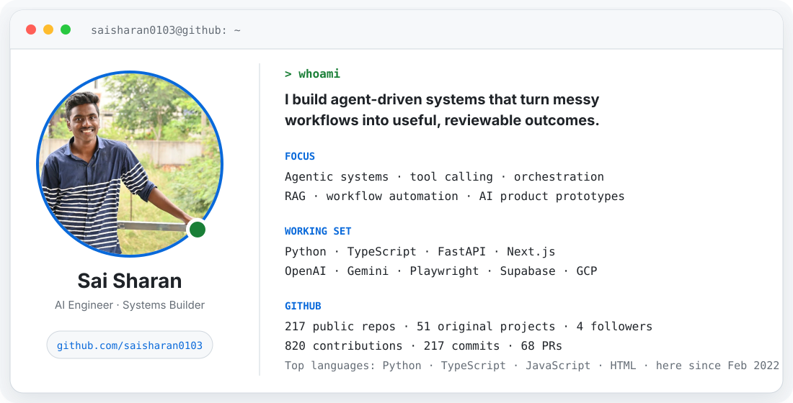

<a href="https://github.com/saisharandomakonda">
  <picture>
    <source media="(prefers-color-scheme: dark)" srcset="https://raw.githubusercontent.com/saisharandomakonda/saisharandomakonda/main/assets/profile-dark.svg">
    
  </picture>
</a>

  <strong>AI Engineer · Systems Builder</strong> 
  Building agent-driven systems that turn messy workflows into useful, reviewable outcomes.

## Selected systems

- **[Deepwork for Windsurf](https://github.com/saisharandomakonda/windsurf-deepwork)** - an evidence-first quality and safety layer for difficult coding work in Cascade.
- **[Codex Control Center](https://github.com/saisharandomakonda/codex-control-center)** - a local-first operations dashboard for durable, auditable Codex CLI runs.
- **[DevGuild Agent](https://github.com/saisharandomakonda/devguild-agent)** - a Discord-native coding teammate that turns developer threads into issues, fixes, and pull requests.
- **[Workflow-to-Agent](https://github.com/saisharandomakonda/workflow-to-agent)** - an AI-readiness and intent-API system for enterprise workflow automation.

## Working set

`Python` · `TypeScript` · `FastAPI` · `Next.js` · `OpenAI` · `Gemini` · `Playwright` · `Supabase` · `GCP` · `Vercel`

> Building AI systems that actually get used — not demos.

The profile card refreshes from the GitHub API. Terminal-profile concept inspired by <a href="https://github.com/Andrew6rant/Andrew6rant">Andrew6rant</a>.
